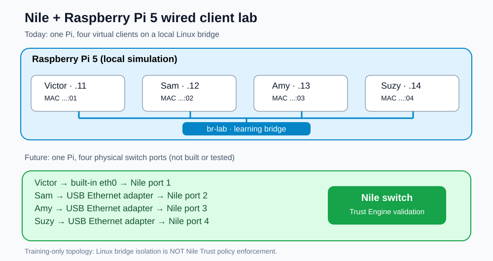

# Nile + Raspberry Pi 5 Wired Network Lab

> **WORK IN PROGRESS (14 Nov 2026)** ·

Build a portable Raspberry Pi 5 network test client capable of simulating **four independent Linux network endpoints** and, in a later phase, connecting them to **four distinct physical Nile switch ports** to investigate onboarding, 802.1X, client visibility and Trust Engine policy enforcement.



## At a glance

| Area | Current status |
|---|---|
| Pi 5, Debian 13 ARM64, remote SSH management via Wi-Fi | **Verified** |
| Four network namespaces: Victor, Sam, Amy, Suzy | **Verified** |
| Four separate virtual Ethernet interfaces with unique MAC addresses | **Verified** |
| Four distinct private static IPs | **Verified** |
| Linux software bridge `br-lab` and port connections | **Verified** |
| Victor → Sam baseline ICMP test (4/4 received) | **Verified** |
| ARP resolution Victor → Sam | **Verified** |
| Linux bridge isolation enabled on four client ports | **Verified** |
| Victor → Sam ICMP with isolation (0/4 received) | **Verified** |
| Four-client continuous traffic simulator | **Instructions supplied, run not confirmed** |
| Eight upstream Nile readiness tools | **Pending source review and installation** |
| USB-Ethernet adapters / wired Nile connection / Trust Policy | **Not tested** |

## Current lab identities

| Virtual client | Namespace | IP | MAC |
|---|---|---|---|
| Victor | `victor` | `10.240.77.11/24` | `02:77:00:00:00:01` |
| Sam | `sam` | `10.240.77.12/24` | `02:77:00:00:00:02` |
| Amy | `amy` | `10.240.77.13/24` | `02:77:00:00:00:03` |
| Suzy | `suzy` | `10.240.77.14/24` | `02:77:00:00:00:04` |

The lab runs inside a **single Pi** using Linux network namespaces and virtual Ethernet (`veth`) pairs. An **internal Linux bridge** lets us practise Layer 2 traffic, ARP, ICMP, and Linux port isolation, **not** Nile-enforced policy.

## Reproduce the learning lab (no switch needed)

Review scripts first; they use `sudo` to create network namespaces and virtual Ethernet devices. They do not connect the Pi's physical `eth0` or management `wlan0` to the lab.

```bash
git clone https://github.com/komalgsr22/nile-raspberry-pi-wired-lab.git
cd nile-raspberry-pi-wired-lab
less scripts/setup-local-lab.sh
sudo bash scripts/setup-local-lab.sh
sudo bash scripts/check-lab.sh

# Allow direct local bridge communication for baseline:
sudo bash scripts/set-local-isolation.sh off
sudo bash scripts/traffic-simulator.sh --once

# Simulate blocked local communication (not Nile policy):
sudo bash scripts/set-local-isolation.sh on
sudo bash scripts/traffic-simulator.sh --once

# Restore local communication and run a limited traffic simulation:
sudo bash scripts/set-local-isolation.sh off
sudo bash scripts/traffic-simulator.sh --rounds 5 --interval 5
```

**Scripts are newly documented and have not yet been independently executed on the user's Pi.** Record actual outputs before marking their automation tested. `--once` and bounded rounds do not require leaving a process running in the background.

To remove **only this named training lab** when ready:

```bash
sudo bash scripts/cleanup-local-lab.sh
```

## Read the full report

- [Complete hands-on journal: all commands, outputs, lessons and troubleshooting](docs/STEP_BY_STEP_LAB.md)
- [Networking concepts explained using analogies](docs/CONCEPTS.md)
- [Observed experimental evidence and untested items](docs/TEST_RESULTS.md)
- [Eight Nile installer projects and review status](docs/NILE_TOOLS.md)
- [Future Nile physical wired design and trust validation](docs/WIRED_NILE_ROADMAP.md)
- [Safety, cleanup, and network boundaries](docs/SAFETY.md)

## Future physical architecture

**The revised plan uses one Pi and FOUR separate wired connections:** built-in `eth0` → Nile port 1, plus **three USB-to-Ethernet adapters** → Nile ports 2–4. Each physical interface would move into its matching namespace (under carefully controlled configuration), while `wlan0` remains for SSH management. The local bridge must **not** interconnect those physical test interfaces, or traffic might bypass Nile.

We considered **one physical cable** carrying four MAC addresses, but a conventional switch normally does not forward traffic back out the ingress port; thus one cable is not a reliable demonstration of Nile client-to-client **allow and deny** policies. Four physical switch ports provide a more faithful topology. **Nothing in this repository claims Nile supports a particular authentication flow or policy by default; this must be validated on an authorized test switch.**

## Credits and boundaries

This repository documents an independent experiment. The original [Austin Hawthorne Nile test-client installer](https://github.com/austinhawthorne/setup-nile-test-client) is referenced but its third-party code is **not copied or executed** here. No production credentials, sensitive network captures, or private customer information should be committed.
